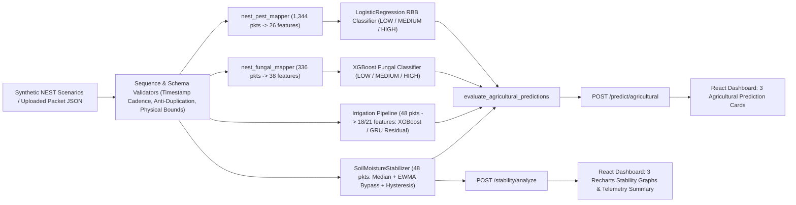

# CropNow — NEST Agricultural Prediction System

**IoT-Based Agricultural Intelligence for Soil Moisture Stabilization, Irrigation Forecasting, Fungal Risk, and Pest Risk**

CropNow pairs an IoT telemetry validation and machine learning inference backend (**FastAPI + PyTorch + XGBoost + scikit-learn**) with a responsive, farmer-friendly **React 19 + Vite** dashboard inspired by CropDesk UI conventions. It transforms noisy 30-minute multi-sensor field packets into stabilized soil moisture curves, 24-hour irrigation guidance, 7-day fungal disease alerts, and 28-day pest outbreak risk classifications—with strict anti-fabrication guards and transparent domain-limitation warnings.

---

## 1. Problem Statement & Overview

Agricultural IoT deployments face three recurring reliability failures in production:
1. **Sensor noise & relay chatter:** Raw dual-probe volumetric soil moisture sensors suffer transient spikes and dropouts (`0%` / `100%`) that cause erratic irrigation pump cycling if fed directly into threshold rules.
2. **Incompatible forecast horizons:** Soil hydrology responds over **24 hours**, fungal germination depends on **7-day** microclimate & leaf wetness persistence, and insect population surges evolve over **28 days**. A single fixed window either blocks urgent irrigation advice or fabricates missing history.
3. **Opaque, uncalibrated ML outputs:** Real field deployments frequently differ in crop type, soil texture, or sensor channel availability compared to historical public research datasets.

CropNow addresses all three problems through independent multi-horizon telemetry validation (`48` / `336` / `1,344` consecutive 30-minute packets), causal dual-probe signal conditioning, residual soil moisture forecasting, and explicit runtime confidence and domain-mismatch disclosures.

> **Important Provenance Notice:** All ML models in this repository were trained on **real external public datasets** and evaluated offline against held-out splits plus **synthetic 48-packet NEST scenarios**. **No continuous multi-week real NEST hardware telemetry dataset is present in this repository, and no live field accuracy validation on physical NEST chilli deployments has been performed.**

---

## 2. Key Features

- **Dual-Probe Sensor Stabilization (`SoilMoistureStabilizer`):**
  - Independently conditions `soil_moisture_1` and `soil_moisture_2` over a 48-packet window using a causal **5-point median spike filter** and **EWMA smoothing** (`alpha = 0.3` in API endpoints).
  - Step-change bypass (`|\Delta| >= 3.0%` triggers fast-track `alpha_fast = 0.95`) preserves sharp irrigation wetting fronts instead of over-smoothing genuine infiltration.
  - Decouples **biological irrigation advisory** (`stabilized_average < MADP`) from a symmetric **Schmitt-trigger hysteresis switch** (`MADP +/- 1.0%`) to eliminate actuator chatter.
- **24-Hour Soil Moisture & Irrigation Prediction (`48` Packets = 24h):**
  - Default **XGBoost Residual** formulation predicts $\widehat{\Delta y} = y_{t+24\text{h}} - y_t$ and reconstructs $\hat{y}_{t+24\text{h}} = y_t + \widehat{\Delta y}$ across crop-specific `PWP`, `MADP`, `FC`, and `SP` thresholds (`chilli`, `tomato`, `zucchini`, `blueberry`, `wheat`, `rice`, `maize`).
  - Also serves **GRU Residual** (`PyTorch`) and legacy Absolute XGBoost/GRU models.
- **7-Day Fungal Disease Risk Classification (`336` Packets = 7 Days):**
  - Aggregates contiguous `[d-7 .. d-1]` 30-minute telemetry into **38 strictly environmental & trend features** (Magnus-Tetens dew point depression, `RH >= 80%` / `90%` hours, leaf wetness hours, rainfall, solar radiation, soil moisture, OLS trends, 3d-vs-4d deltas) for a regularized `XGBoost` classifier (`LOW` / `MEDIUM` / `HIGH`).
- **28-Day Pest Outbreak Risk Classification (`1,344` Packets = 28 Days):**
  - Aggregates 4 weekly blocks of weather and calibrated soil wetness into **26 environmental-only features** (daily precipitation rate, circular wind direction vector mean + `sin`/`cos`, normalized `GWETTOP`, 1-week lags, and 4-week rolling means/trends) for a regularized `LogisticRegression` pipeline (`LOW` / `MEDIUM` / `HIGH`).
- **Fail-Closed Anti-Fabrication Guards:**
  - Automatically rejects sequences with insufficient packets, non-30-minute gaps, duplicate timestamps, duplicated/zero-variance sensor blocks, NaNs, or physical range anomalies without padding or inventing history.
- **Farmer-Focused Interactive Dashboard:**
  - Compact live sensor cards with plain-language tooltips, prominent Pest / Irrigation / Fungal prediction cards with *"What does this mean?"* next-action guidance, interactive Recharts raw-vs-filtered telemetry & valve charts, synthetic scenario runner, `48` / `336` / `1,344`-packet JSON uploader, and collapsible Technical Details.

---

## 3. Technology Stack

| Layer | Technologies |
| :--- | :--- |
| **Backend API** | Python `3.11+`, FastAPI, Uvicorn (`uvicorn[standard]`), Pydantic v2 |
| **ML & Signal Processing** | XGBoost (`>=3.2,<4.0`), scikit-learn (`~=1.9.0`), PyTorch (`>=2.0,<3.0` GRU inference), pandas, NumPy, joblib |
| **Frontend UI** | React `19` (`^19.3.1`), Vite (`^8.3.6`), Recharts (`^3.10.1`), oxlint (`^1.90.0`) |
| **Testing & Offline Visualization** | pytest (`112` backend tests), httpx (`TestClient`), matplotlib (lazy-imported only in offline training/evaluation scripts) |

---

## 4. System Architecture



---

## 5. Project Structure

```text
CropNow/
├── backend/
│   ├── app/
│   │   ├── main.py                        # FastAPI initialization, CORS, ModelRegistry lifespan
│   │   ├── routes/                        # health.py, prediction.py, stability.py
│   │   ├── schemas/                       # Pydantic v2 contracts (agricultural, prediction, stability)
│   │   ├── services/                      # inference.py, agricultural.py, stability_metrics.py
│   │   ├── utils/                         # config.py (CORS & app metadata)
│   │   └── ml/
│   │       ├── fungal_features.py         # Standalone 38-feature fungal schema
│   │       ├── nest_fungal_mapper.py      # 336-packet NEST -> 38 fungal features
│   │       ├── nest_pest_mapper.py        # 1,344-packet NEST -> 26 pest features
│   │       ├── stability.py               # MedianFilter, EWMASmoother, HysteresisSwitch
│   │       ├── pipeline.py / residual_pipeline.py
│   │       ├── prepare_*.py / train_*.py / evaluate_saved_models.py
│   │       ├── models/                    # Absolute XGBoost + GRU irrigation artifacts
│   │       ├── models_residual/           # Residual XGBoost (default) + GRU artifacts
│   │       ├── models_fungal_risk/        # Saved XGBoost fungal classifier + metadata
│   │       ├── models_pest_risk/          # Saved LogisticRegression pest classifier + metadata
│   │       └── evaluation/                # Offline evaluation scripts, metrics JSONs, reports & plots
│   ├── tests/                             # 8 pytest suites (112 automated tests)
│   ├── requirements.txt                   # Core runtime API & model inference dependencies
│   ├── requirements-dev.txt               # Includes pytest, httpx, and matplotlib
│   └── README.md
├── frontend/
│   ├── src/
│   │   ├── App.jsx / App.css              # CropDesk-inspired dashboard & layout
│   │   ├── services/api.js                # Backend health, stability, and agricultural API client
│   │   └── components/                    # AgriculturalPredictions, SensorCards, TechnicalDetails, InfoTip
│   ├── package.json
│   └── vite.config.js
├── data/
│   ├── README.md                          # Provenance registry & dataset citations
│   ├── synthetic_nest/                    # 5 SYNTHETIC 48-packet demo CSVs + generator/audit scripts
│   ├── Soil Moisture, Irrigation Actuator and Weather Dat/  # External Mendeley trial (CC BY 4.0)
│   ├── external/pest/fungal_flax_rust/    # External Dryad wild flax rust dataset (CC0 1.0)
│   └── processed/fungal_risk/             # Engineered 7-day lookback fungal training dataset
├── docs/
│   ├── TECHNICAL_REPORT.md                # Full architecture, provenance, metrics & limitations report
│   ├── DEMO_GUIDE.md                      # Step-by-step UI/API demo walkthrough (48 / 336 / 1,344 pkts)
│   ├── CLEANUP_AUDIT.md
│   ├── DEPENDENCY_AUDIT.md
│   ├── FINAL_CLEANUP_REPORT.md
│   └── GITHUB_UPLOAD_AUDIT.md
├── .gitignore
├── pyrightconfig.json
└── README.md
```

*(Note: Locally excluded from public Git tracking via `.gitignore` are raw `>100 MB` actuator CSVs, `data/company_sample/nest_sample.json`, `data/processed/pest_risk/`, and third-party pest/grape CSVs lacking public redistribution licenses.)*

---

## 6. Installation & Running Locally

### Prerequisites
- **Python:** `3.11+`
- **Node.js & npm:** `Node 18+` recommended

### 1. Backend API (`http://127.0.0.1:8000`)

```powershell
cd backend
python -m venv venv
.\venv\Scripts\Activate.ps1
# Use requirements.txt for API runtime, or requirements-dev.txt for tests & plots
pip install -r requirements-dev.txt

uvicorn app.main:app --reload --host 127.0.0.1 --port 8000
```

Interactive documentation is available at `http://127.0.0.1:8000/docs` and `http://127.0.0.1:8000/redoc`.

### 2. React Dashboard (`http://localhost:5173`)

```powershell
cd frontend
npm install
# Optional: copy .env.example to .env to customize VITE_API_BASE_URL
npm run dev
```

### 3. Automated Tests, Lint & Build

```powershell
# From repository root (112 pytest tests covering mappers, stability, datasets & APIs)
python -m pytest backend/tests -v

# From frontend/
npm run lint
npm run build
```

---

## 7. API Endpoint Overview

| Method | Endpoint | Purpose |
| :---: | :--- | :--- |
| `GET` | `/` | Root service overview and endpoint directory |
| `GET` | `/health` | Service status, timestamp, and app version (`0.1.0`) |
| `GET` | `/predict/models` | Loaded irrigation models (`xgb_residual`, `gru_residual`, `xgb`, `gru`) and supported crops |
| `POST` | `/predict/agricultural` | Unified multi-horizon evaluation (Irrigation `48`, Fungal `336`, Pest `1,344` pkts) with independent readiness & domain warnings |
| `POST` | `/predict/quick` | Single-packet schema validation & immediate threshold advice (`temporal_prediction` marked unavailable) |
| `POST` | `/predict/batch` | Standalone 48-packet soil moisture forecast |
| `POST` | `/stability/analyze` | Raw vs. stabilized dual-probe traces, valve switching comparison, and stability metrics |
| `GET` | `/stability/scenarios` | Lists the 5 predefined synthetic 48-packet NEST demo scenarios |
| `GET` | `/stability/scenarios/{scenario_id}` | Returns the 48 `SYNTHETIC` telemetry packets for the selected demo scenario |

---

## 8. Model Evaluation Highlights & Honest Limitations

### Offline Evaluation Highlights

- **Irrigation Forecasting (`target_mean_24h` on Italian Arnesano Zones 1, 2, 4, 5):**
  - Switching from absolute regression (`6.440%` MAE) to **XGBoost Residual** ($\hat{y}_{t+24\text{h}} = y_t + \widehat{\Delta y}$) reduced overall MAE to **`0.465%`** (`0.608%` RMSE) and cut Zone 5 Blueberry MAE from `15.161%` to **`0.475%`** (`96.9%` reduction).
  - By comparison, a trivial Persistence baseline ($\widehat{\Delta y}=0$) achieves `0.383%` pooled test MAE on slow-moving 30-minute moisture trajectories (`0.00%` contiguous switching oscillation observed for both saved models across `1,229` contiguous pairs).
- **Signal Stability (`SoilMoistureStabilizer`, 5 synthetic 48-packet scenarios):**
  - **`scenario_02_sensor_noise`:** **`99.8%` outlier suppression**, `99.22%` TV noise reduction, and **`2 -> 0`** false actuator switches eliminated on injected `0%` / `100%` spikes.
  - **`scenario_04_irrigation_event`:** Fast-track EWMA bypass preserves **`95.53%`** genuine moisture step range with `60.0 min` trajectory delay from the causal 5-point median window.
- **Fungal Risk Classifier (`XGBoost`, `max_depth=2`, `n=70`, fold-only tertile cutoffs):**
  - **Leave-One-Year-Out (`2020–2023`):** Macro F1 **`0.5121`**, Balanced Accuracy **`0.5170`**.
  - **Leave-One-Site-Out (`BT, CC, GM, HM`):** Macro F1 **`0.3734`**, Balanced Accuracy **`0.3787`**.
- **Pest Risk Classifier (`LogisticRegression`, `RBB` counts, `n=209` pooled chronological OOF across `2021–2024`):**
  - **4-Fold Walk-Forward OOF:** Macro F1 **`0.4164`**, Balanced Accuracy **`0.4372`**, Accuracy **`0.4163`** (`2024` holdout Macro F1 `0.3796`).

### Known Limitations

1. **Zero Real Multi-Week NEST Validation:** Models have not yet been benchmarked on continuous field telemetry streamed from live NEST chilli hardware.
2. **Cross-Crop & Climate Domain Mismatch:** Irrigation models were trained on Italian Tomato, Zucchini, and Blueberry (`MADP = 40–80%`), Fungal Risk on Colorado subalpine wild flax rust (`10.2–18.9°C`, triggering `OUT_OF_DISTRIBUTION_CLIMATE` warnings at `25–35°C`), and Pest Risk on weekly wetland rice Rice Black Bug trap counts. The API explicitly attaches `DOMAIN_LIMITATION` flags whenever evaluated on target crops like `chilli`.
3. **Imputed Unmeasured Training Channels (`z = 0.0`):** Five training columns (`ec`, `ph`, `irrigation_duration_minutes`, `water_vol_past_4h`, `soil_temperature_7-18cm`) are unavailable in standard 21-field NEST telemetry and default to training-mean `z = 0.0` normalization with explicit reliability warnings.
4. **Soil Wetness Calibration Assumption (`GWETTOP`):** Pest inference estimates NASA POWER top-layer wetness via `SM_avg / SP`; soil texture changes shift saturation point `SP` calibration.
5. **Demo Scenario Window Length:** Built-in synthetic scenarios provide `48` packets (`24h`), which activates Irrigation/Stability immediately while leaving Fungal (`336` pkts) and Pest (`1,344` pkts) in `INSUFFICIENT HISTORY` until multi-day/multi-week sequences are uploaded.

---

## 9. Dataset Provenance & Synthetic-Data Distinction

| Dataset | Role | License & Source | Synthetic vs. Real |
| :--- | :--- | :--- | :--- |
| **Italian Multi-Sector Precision-Irrigation Trial** (`data/Soil Moisture.../`) | Soil moisture forecasting (`XGBoost`, `GRU` & Residual models) | **CC BY 4.0** — Adamo et al. (2026), Mendeley Data DOI [`10.17632/c837v6p8ph`](https://doi.org/10.17632/c837v6p8ph) (`10.17632/c837v6p8ph.2`); weather from Open-Meteo ERA5 (**CC BY 4.0**) | **Real external public field data** (`raw_actuators.csv` / `raw_measurements.csv` >100 MB excluded from Git) |
| **Colorado Wild Flax Rust Pathosystem** (`data/external/pest/fungal_flax_rust/`, `data/processed/fungal_risk/`) | 7-day fungal disease severity training & CV (`n=70`, `38` features) | **CC0 1.0** — Duggal et al., Dryad DOI [`10.5061/dryad.98sf7m0tc`](https://doi.org/10.5061/dryad.98sf7m0tc); Miller et al. (*Sci Rep* 2022) | **Real external public ecological data** |
| **Weekly Rice Black Bug (`RBB`) & NASA POWER Records** *(excluded from GitHub)* | 28-day pest risk classifier (`n=363`, `26` env features) | Undocumented trap-count source on local disk (`best_pest_model.joblib` artifact preserved; raw & derived CSVs excluded from Git) | **Real external trap/weather data** (local training only) |
| **Synthetic NEST Scenarios** (`data/synthetic_nest/scenario_01..05.csv`) | Stability benchmarks, pytest integration, and UI live demos (`48` pkts each, `chilli`) | Project-authored (`generate_synthetic.py`, `seed=42`) | **`SYNTHETIC`** (`data_source="SYNTHETIC"`) — simulated telemetry conforming to NEST schema, never field data |

---

## 10. Detailed Documentation

- **[Technical Report (`docs/TECHNICAL_REPORT.md`)](docs/TECHNICAL_REPORT.md):** Deep-dive into multi-horizon architecture, residual modeling rationale, evaluation tables across all 4 model families, stability metrics, and deployment risks.
- **[Demo Guide (`docs/DEMO_GUIDE.md`)](docs/DEMO_GUIDE.md):** Step-by-step instructions to launch both servers, test Scenarios 1–4, generate synthetic `336`- and `1,344`-packet JSON payloads, and inspect live warnings.
