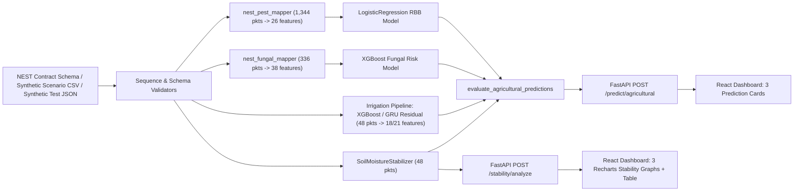

# NEST Agricultural Prediction System — Technical Report

**Version:** 0.1.0
**Scope:** End-to-end IoT telemetry ingestion, dual-probe soil moisture signal conditioning, 24-hour irrigation forecasting, 7-day fungal-risk classification, 28-day pest-risk classification, FastAPI backend, and React dashboard.
**Verification Date:** November 10, 2026

> **Strict Provenance & Validation Notice:**
> All biological and hydrological models were trained on **real external public datasets** (Italian precision irrigation trials, Colorado subalpine flax rust surveys, and Rice Black Bug weekly light-trap/NASA POWER records) and validated offline on held-out/cross-validated splits of those datasets plus **synthetic 48-packet NEST scenarios**. **No multi-week real live NEST hardware telemetry dataset exists in this repository, and no live field accuracy validation on NEST hardware or chilli crops has been performed.**

---

## 1. System Architecture

The platform separates signal validation, multi-horizon feature aggregation, model inference, and agricultural decision presentation across a FastAPI backend (`127.0.0.1:8000`) and a React 19 + Vite dashboard (`localhost:5173`).



### Core Backend Modules
- **API Entrypoint ([`main.py`](../backend/app/main.py)):** Initializes CORS (`http://localhost:5173`, `http://127.0.0.1:5173`, `http://localhost:3000`), pre-loads ML models into [`ModelRegistry`](../backend/app/services/inference.py) via FastAPI lifespan, and mounts routes (`/health`, `/predict/*`, `/stability/*`).
- **Unified Agricultural Endpoint ([`prediction.py`](../backend/app/routes/prediction.py), [`agricultural.py`](../backend/app/services/agricultural.py)):** Exposes `POST /predict/agricultural`, slicing only the trailing genuine window required by each model (`[-48:]`, `[-336:]`, `[-1344:]`) and evaluating readiness independently (`ready`, `insufficient_history`, or `blocked`).
- **Dual-Probe Signal Conditioner ([`stability.py`](../backend/app/ml/stability.py), [`routes/stability.py`](../backend/app/routes/stability.py)):** Processes 48-packet `soil_moisture_1` and `soil_moisture_2` channels separately through 5-point median filtering, EWMA smoothing (`ewma_alpha = 0.3` in production endpoints) with $|\Delta| \ge 3.0\%$ fast-track bypass ($\alpha_{\text{fast}} = 0.95$), and symmetric hysteresis valve switching (`MADP ± 1.0%`).
- **Biological Feature Adapters ([`nest_fungal_mapper.py`](../backend/app/ml/nest_fungal_mapper.py), [`nest_pest_mapper.py`](../backend/app/ml/nest_pest_mapper.py)):** Reject incomplete, gapped, out-of-order, duplicated/fabricated, NaN, or physically out-of-bounds histories via [`InsufficientHistoryError`](../backend/app/services/inference.py#L48-L54) and [`PredictionBlockedError`](../backend/app/services/inference.py#L43-L45). Missing history is **never padded or fabricated**.

---

## 2. Data Provenance Matrix (Real vs. Processed vs. Synthetic)

Strict boundaries separate real field research data, processed tabular training datasets, contract reference samples, and synthetic demo telemetry:

| Category | Dataset / Artifact | Location | Scope & Cadence | Notes & Exclusions |
| :--- | :--- | :--- | :--- | :--- |
| **Real Public Data (Irrigation)** | Multi-Sector Precision Irrigation Trial (Arnesano, Lecce, Italy, 2025) + Open-Meteo ERA5 | `data/Soil Moisture, Irrigation Actuator and Weather Dat/.../02_processed_data/preprocessed/` | Tomato Zones 1–3, Zucchini Zone 4, Blueberry Zone 5; nominal 10-min bins (`1,118–12,676` rows/zone) | Real field trial data. Zone 3 discarded for 24h sequence modeling (`0` contiguous 48-packet 30-min blocks). Leakage columns `real_moisture_delta` and future `water_vol_to_24h` excluded. |
| **Real Public Data (Fungal Disease)** | Colorado Subalpine Wild Flax Rust (*Melampsora lini*, Dryad `10.5061/dryad.98sf7m0tc`) | `data/external/pest/fungal_flax_rust/` | Sites `BT, CC, GM, HM` (2019–2023); `126` `Cleaned_Epi.rds` site surveys + `291,264` 5-min temp & `191,477` 5-min weather rows | Real ecological dataset. `2019` (`23` surveys) lacks leaf wetness/rain (`cleaned_weather.rds` starts 2020). `HM 2023` wind sensor offline (`13,498` NAs). |
| **Real Public Data (Pest Counts)** | Weekly Rice Pest Counts & NASA POWER Weather + Moon Category | `data/external/pest/weekly_lot_a_with_moon_dataset.csv` | `366` weekly records (`2018–2024`) with Rice Black Bug (`RBB`) & White Stem Borer (`WSB`) | `RBB_P75.1_binary_labels.csv` and `WSB_P94.3_binary_labels.csv` contain derived interleaved `Data_Split` (`train`/`test` mixed across years — rejected). |
| **Excluded External Data** | Grape Leaf / Environment Sensor Log | `data/external/pest/fungal/Grape Disease Dataset/Grape_Disease_Dataset.csv` | Environmental burst log | **Audited & excluded:** Unlabeled (no target labels), non-monotonic timestamps, 105-day gap, and no rainfall telemetry. |
| **Reference Schema Contract** | Company NEST Hardware Reference Sample | `data/company_sample/nest_sample.json` | Single 21-field packet (`30-min` contract) | Structural reference only (`temperature`, `humidity`, `leaf_wetness`, `rainfall`, `solar_radiation`, `pressure`, `wind_speed`, `wind_direction`, `soil_moisture_1`, `soil_moisture_2`, `soil_temperature`, `co`, `no2`, `o3`, `pm2_5`, `crop_id`, `device_id`, `farm_id`, `month`, `day`, `hour`). |
| **Processed Training Data (Fungal)** | Engineered 7-Day Lookback Flax Rust Table | `data/processed/fungal_risk/flax_rust_fungal_risk_dataset.csv` | `70` rows $\times$ `52` columns (`38` environmental features, `0` nulls) | Built by `prepare_fungal_dataset.py` using `[d-7 .. d-1]` 5-min history with `>= 270/288` valid daily bins (`2020–2023`). |
| **Processed Training Data (Pest)** | Chronological Weekly RBB Dataset (`WSB` isolated) | `data/processed/pest_risk/rbb_pest_risk_dataset.csv` | `363` rows $\times$ `33` columns (`26` env features, `0` nulls); `wsb_pest_counts_separate.csv` stored separately | Built by `prepare_pest_dataset.py`. Repaired 3 ISO-week year-boundary errors; trimmed 3 warm-up weeks; removed `Moon_Category` & calendar proxies. |
| **Synthetic Telemetry** | 5 Predefined NEST Operational Scenarios | `data/synthetic_nest/scenario_01_normal.csv` .. `scenario_05_high_humidity.csv` | `48` packets each (`24h` @ `30-min`), `crop_id: chilli` | Generated by `generate_synthetic.py` strictly for pipeline and stability verification; always tagged `SYNTHETIC`. |

---

## 3. Packet History Windows & Hardware Mapping

Because agricultural hydrology, fungal germination, and insect population dynamics evolve across distinct timescales, `POST /predict/agricultural` enforces independent packet requirements per model at NEST's 30-minute sampling cadence:

| Subsystem | Required Consecutive Packets | Physical Lookback | Engineered Features | Hardware Mapping & Unit Conversions |
| :--- | :---: | :---: | :---: | :--- |
| **Irrigation & Stability** | **`48`** | 24 hours (`48 × 30 min`) | `18` cols (`878` flat XGB) / `21` cols (`1,025` residual XGB) | `(soil_moisture_1 + soil_moisture_2)/2`, `pressure` (`kPa × 10 -> hPa`), crop thresholds (`PWP/MADP/FC/SP`), plus 5 unavailable training channels imputed at `z=0.0` baseline. |
| **Fungal Risk (`XGBoost`)** | **`336`** | 7 days (`7 × 48` packets) | **`38`** | Aggregates `[d-7 .. d-1]` daily stats & trends, converts soil moisture `% / 100.0 -> 0–1`, counts duration hours as `packets × 0.5 h`, and derives `dew_point` via Magnus-Tetens from `temperature` & `humidity`. |
| **Pest Risk (`LogisticRegression`)** | **`1,344`** | 28 days / 4 weeks (`4 × 336` packets) | **`26`** | Aggregates 4 contiguous 7-day blocks, converts `rainfall` to daily rate (`sum / 7.0` for `PRECTOTCORR`), normalizes soil wetness (`((SM1+SM2)/2) / SP -> GWETTOP`), computes circular vector mean `WD2M` + `sin`/`cos`, and derives 1w lags & 4w trends. |

### Telemetry Integrity & Unavailable Feature Policy
1. **No Synthetic History Padding:** Sequences shorter than `48`, `336`, or `1,344` packets return `status: "insufficient_history"` (`ready: false`) with exact packet counts (`packets_provided / packets_required`).
2. **Temporal & Anti-Fabrication Guards:** Gaps (`delta != 30 min`), duplicate timestamps, out-of-order packets, zero-variance duplicated consecutive windows, or physical range violations return `insufficient_history` or `blocked` for the affected window only (e.g., corruption in older week-1 packets blocks `pest_risk` while keeping recent `48`-packet `irrigation` and `336`-packet `fungal_risk` operational).
3. **Irrigation Unavailable Training Channels (`z=0.0` Imputation):** Five training features (`ec` = 181.747 µS/cm, `ph` = 5.972, `irrigation_duration_minutes` = 0.188 min, `water_vol_past_4h` = 1.743 L, `soil_temperature_7-18cm` = 28.683°C) are absent in standard NEST payloads. Rather than injecting biased constants, `ModelRegistry` sets their scaler-normalized inputs to `z = 0.0` and attaches explicit reliability warnings returned in the API response and displayed in the UI.

---

## 4. Feature Engineering & Model Evaluation Results

### 4.1 Irrigation Forecasting (`XGBoost` vs. `GRU`, Absolute vs. Residual)

Both XGBoost and 2-layer GRU (`Linear(64,32) -> ReLU -> Dropout -> Linear(32,1)`) architectures were evaluated without retraining on held-out test partitions across Arnesano Zones 1, 2, 4, and 5 (`target_mean_24h`).

#### Finding 1: Extrapolation Barrier in Absolute Formulations (`backend/app/ml/models/`)
Tree-based absolute models cannot extrapolate below their training floor (22.8%), causing severe bias on dry soil zones (e.g., Zone 5 Blueberry test moisture near 1–2%):

| Formulation / Model | Overall Test MAE | Overall Test RMSE | Zone 1 (Tomato) MAE | Zone 2 (Tomato) MAE | Zone 4 (Zucchini) MAE | Zone 5 (Blueberry) MAE | Binary Irrig. Acc | 5-Class Macro F1 |
| :--- | :---: | :---: | :---: | :---: | :---: | :---: | :---: | :---: |
| **Persistence Baseline** ($\widehat{\Delta y}=0$) | 0.383% | 0.547% | 0.424% | 0.442% | 0.319% | 0.361% | 100.0% | 94.3% |
| **Pretrained XGBoost (Absolute)** | 6.440% | 8.850% | **0.165%** | **0.803%** | 7.566% | 15.161% | **100.0%** | **99.7%** |
| **Pretrained GRU (Absolute)** | 5.784% | 7.716% | 0.486% | 1.209% | 7.367% | 12.288% | 100.0% | 93.8% |
| **XGBoost Residual (`models_residual/`)** | **0.465%** | **0.608%** | 0.556% | 0.509% | **0.357%** | **0.475%** | — | — |
| **GRU Residual (`models_residual/`)** | **0.822%** | **1.180%** | **0.301%** | **0.306%** | 0.538% | 1.993% | — | — |

- **Residual Learning Improvement:** Predicting $\widehat{\Delta y} = \text{target\_mean\_24h} - y_t$ and reconstructing $\hat{y}_{t+24\text{h}} = y_t + \widehat{\Delta y}$ reduced Zone 5 Blueberry MAE from **15.161% to 0.475%** (**96.9% error reduction**) and pooled XGBoost MAE from **6.440% to 0.465%** (`xgb_residual` is therefore the default in `POST /predict/agricultural`). Note that on slow-moving 30-minute moisture averages across Zones 1–5, pooled test MAE (`0.465%`) still slightly exceeds the trivial Persistence Baseline (`0.383%`), and binary/5-class threshold accuracy in the evaluation reports was benchmarked only on the original absolute models (`models/`).
- **Contiguous Switching Stability (Evaluated on 1,229 contiguous test pairs):** `0.00%` binary irrigation flip rate for both XGBoost and GRU, confirming absence of prediction-induced oscillation.

### 4.2 Dual-Probe Signal Conditioning & Hysteresis Stability (`SoilMoistureStabilizer`)

Evaluated across all 5 synthetic NEST scenarios (`48` packets each, `chilli` thresholds `MADP = 20.0%`, hysteresis `ON < 19.0%` / `OFF > 21.0%`, production backend `ewma_alpha = 0.3`):

| Scenario (`SYNTHETIC`) | TV Noise Reduction | High-Freq Jitter Reduction | Genuine Range Retention | Outlier Suppression | Response Delay | Raw Switches | Filtered Switches |
| :--- | :---: | :---: | :---: | :---: | :---: | :---: | :---: |
| **`scenario_01_normal`** | 11.63% | 96.22% | 96.21% | N/A (`0` spikes) | 120.0 min | 0 | **0** |
| **`scenario_02_sensor_noise`** | **99.22%** | **100.0%** | **90.26%** | **99.8%** (`2` spikes: `100%`, `0%`) | 0.0 min | 2 | **0** |
| **`scenario_03_gradual_drying`** | 8.92% | 94.02% | 91.08% | N/A (`0` spikes) | 150.0 min | 1 | **0** |
| **`scenario_04_irrigation_event`** | 9.33% | -45.02% | **95.53%** | N/A (`0` spikes) | **60.0 min** *(2 steps; 5 bypass events)* | 1 | **1** |
| **`scenario_05_high_humidity`** | 63.33% | 98.34% | 78.12% | N/A (`0` spikes) | 120.0 min | 0 | **0** |

- **Decoupled Control & Anomaly-Guard Behavior:** `irrigation_advisory` monitors biological stress (`stabilized_average < MADP`) independently of `irrigation_decision` (the Schmitt hysteresis actuator state), preventing `0%` hardware dropout spikes from cycling valves (`2 -> 0` switches in Scenario 2) while EWMA fast-tracking ($\alpha_{\text{fast}} = 0.95$ on $|\Delta| \ge 3.0\%$) detects 5 infiltration steps in Scenario 4 (`95.53%` genuine range retention, `60.0 min` overall trajectory lag from the causal 5-point median window). In `scenario_02_sensor_noise`, physical-range anomaly guards block `POST /predict/agricultural` ML irrigation inference (`status: "blocked"` due to synthetic `-5.0%` humidity and extreme temperature faults), while `POST /stability/analyze` still processes the trace to visualize outlier suppression. *(Per [`scenario_data_audit.md`](../backend/app/ml/evaluation/scenario_data_audit.md), Scenarios 1–3 look visually similar on charts because all three yield `0` filtered actuator switches, `0` sudden infiltration steps, and overlap around `21–30%` soil moisture.)*

### 4.3 Fungal Risk Classifier (`LOW / MEDIUM / HIGH`)

- **Dataset:** `data/processed/fungal_risk/flax_rust_fungal_risk_dataset.csv` (`70` site-date rows $\times$ `38` environmental features over 2020–2023).
- **Features (`38`):** Temperature (`8`, including dew point & diurnal range), Humidity (`7`, including $\text{RH} \ge 80\%$ & $\ge 90\%$ hours), Leaf Wetness (`7`, including `lw > 0` and favorable `5–25°C` infection hours), Rainfall/Soil/Solar (`7`), and 7-day OLS slopes + 3d-vs-4d deltas (`9`).
- **Validation Protocol:** Both Leave-One-Year-Out (`LOYO`, 4 folds `2020–2023`) and Leave-One-Site-Out (`LOSO`, 4 folds `BT, CC, GM, HM`) with prevalence tertile cutoffs (`q33`, `q67`) computed strictly inside each training fold only (no GRU used due to `n=70`).

| Model | LOYO Macro F1 | LOYO Bal. Acc | LOSO Macro F1 | LOSO Bal. Acc | Mean Macro F1 | Mean Bal. Acc |
| :--- | :---: | :---: | :---: | :---: | :---: | :---: |
| **LogisticRegression** | 0.4904 | 0.4843 | 0.3688 | 0.3731 | 0.4296 | 0.4287 |
| **ShallowRandomForest** (`max_depth=3`) | 0.4193 | 0.4135 | 0.3279 | 0.3259 | 0.3736 | 0.3697 |
| **XGBoost** (`max_depth=2`, **Selected Best**) | **0.5121** | **0.5170** | **0.3734** | **0.3787** | **0.4427** | **0.4478** |

- **Per-Class Performance (`XGBoost`, LOYO `n=70`):** `LOW` F1=`0.5385` (Precision `0.4667`, Recall `0.6364`), `MEDIUM` F1=`0.4762` (Precision `0.5263`, Recall `0.4348`), `HIGH` F1=`0.5217` (Precision `0.5714`, Recall `0.4800`).
- **Top Features (`XGBoost`):** `temp_max_7d` (`0.0528`), `soil_moisture_mean_7d` (`0.0485`), `temp_mean_7d` (`0.0484`), `lw_max_7d` (`0.0470`), `temp_mean_24h` (`0.0459`).

### 4.4 Pest Risk Classifier (`RBB` `LOW / MEDIUM / HIGH`)

- **Dataset:** `data/processed/pest_risk/rbb_pest_risk_dataset.csv` (`363` chronological weekly rows $\times$ `26` environmental-only features; `WSB` isolated; `Moon_Category` excluded).
- **Features (`26`):** Weekly weather/soil metrics (`10`), intra-week diurnal/wind spreads & circular `wd_sin`/`wd_cos` (`4`), 1-week causal lags (`5`), 4-week rolling means/sums (`4`), and 4-week OLS trend slopes (`3`).
- **Validation Protocol:** Expanding-window chronological walk-forward across `2021–2024` (`n=209` pooled out-of-fold predictions; `n=53` in 2024 holdout) replacing the leaky interleaved `Data_Split`, with RBB count tertiles (`q33 = 1.0–4.0`, `q67 = 117.0–145.0`) computed strictly inside each prior-year training fold only (no GRU used).

| Model | 4-Fold Pooled Macro F1 | 4-Fold Balanced Acc | 4-Fold Accuracy | 2024 Holdout Macro F1 | 2024 Holdout Bal. Acc |
| :--- | :---: | :---: | :---: | :---: | :---: |
| **XGBoost** | 0.3451 | 0.3454 | 0.3589 | 0.4789 | **0.5500** |
| **ShallowRandomForest** | 0.3454 | 0.3451 | 0.3589 | **0.5100** | 0.5302 |
| **LogisticRegression** (**Selected Best**) | **0.4164** | **0.4372** | **0.4163** | 0.3796 | 0.4364 |

- **Per-Class Performance (`LogisticRegression`, 4-Fold Pooled OOF `n=209`):** `LOW` F1=`0.4252` (Precision `0.3418`, Recall `0.5625`, `n=48`), `MEDIUM` F1=`0.4146` (Precision `0.3953`, Recall `0.4359`, `n=78`), `HIGH` F1=`0.4094` (Precision `0.5909`, Recall `0.3133`, `n=83`).
- **Top Environmental Drivers (`LogisticRegression`):** `T2M_MAX` (`0.3833`), `gwettop_trend_4w` (`0.3070`), `WS2M` (`0.3017`), `t2m_lag_1w` (`0.2331`), `T2M` (`0.2156`).

---

## 5. System Verification Summary

Verified against the current codebase on November 10, 2026:
- **Backend Automated Test Suite (`python3.11 -m pytest backend/tests -v`):** **112 / 112 passed** (`11.40s`) covering sequence anti-fabrication, physical range guards, feature parity against saved artifacts (`best_fungal_model.joblib`, `best_pest_model.joblib`, `models_residual/`), dual-probe stability, `/stability/*` endpoints, and `/predict/agricultural` across `24`, `48`, `336`, `1,344` packets plus corrupted older-window isolation.
- **Live HTTP Endpoint Check (`http://127.0.0.1:8000/predict/agricultural`):** Verified HTTP `200 OK` responses on `48`, `336`, and `1,344`-packet synthetic `chilli` inputs confirming independent readiness transitions, confidence scoring, and explicit domain warnings.
- **Frontend Lint, Build & Headless Browser E2E (`http://localhost:5173/`):** `oxlint` passed (`0 warnings, 0 errors`), `vite build` succeeded cleanly (`266ms`), and headless Chrome CDP inspection verified all 3 agricultural cards, preserved 3 Recharts stability charts, `0` console errors, and `0` uncaught exceptions across initial load, Scenario 1 (`48` pkts), uploaded `336` pkts, and uploaded `1,344` pkts.

---

## 6. Setup & Quick Commands

```powershell
# Terminal 1 — FastAPI Backend (port 8000)
cd backend
python -m venv venv
.\venv\Scripts\Activate.ps1
pip install -r requirements.txt
uvicorn app.main:app --reload --host 127.0.0.1 --port 8000

# Terminal 2 — React + Vite Frontend (port 5173)
cd frontend
npm install
npm run dev
```

Automated checks:
- Backend tests (from repo root): `python -m pytest backend/tests -v`
- Frontend lint & build (from `frontend/`): `npm run lint && npm run build`

---

## 7. Known Limitations & Deployment Risks

1. **Zero Real Multi-Week NEST Field Validation:** Models have not been evaluated on continuous multi-week field streams emitted by physical NEST chilli sensors.
2. **Severe Crop & Climate Domain Mismatch (`chilli`):**
   - **Irrigation:** Trained on Italian **Tomato, Zucchini, and Blueberry** (`MADP = 40–80%`), whereas target NEST scenarios use **chilli** (`MADP = 20%`).
   - **Fungal Risk:** Trained on **Colorado subalpine wild flax rust** (*Melampsora lini*, 7-day mean temp `10.2–18.9°C`, `n=70`, LOYO Macro F1 `0.5121` / LOSO `0.3734`). Tropical/subtropical `chilli` deployments (`25–35°C`) trigger `OUT_OF_DISTRIBUTION_CLIMATE` warnings and `DOMAIN_LIMITATION (Flax Rust -> chilli)`.
   - **Pest Risk:** Trained on **weekly Rice Black Bug (`RBB`)** in wetland rice (4-fold pooled Macro F1 `0.4164`), predicting insect trap surges in rice rather than chilli pests, triggered with `DOMAIN_LIMITATION (Rice RBB -> chilli)`.
3. **Soil Wetness Calibration Assumption (`GWETTOP`):** Pest inference approximates NASA POWER top-layer wetness fraction (`GWETTOP`) via `SM_avg / SP`. Changing soil type alters saturation point `SP` and shifts `StandardScaler` alignment.
4. **Imputed Soil/Irrigation Channels (`z=0.0`):** `ec`, `ph`, `irrigation_duration_minutes`, `water_vol_past_4h`, and `soil_temperature_7-18cm` are absent in current 21-field NEST telemetry and imputed at training means (`z=0.0`), increasing forecast uncertainty during active fertigation or unmonitored irrigation.
5. **History Window Constraint on Scenario Demos:** Built-in synthetic scenarios provide `48` packets (`24h`), which satisfies irrigation (`48`) but intentionally yields `INSUFFICIENT HISTORY` for fungal (`336`) and pest (`1,344`) models unless `336+` or `1,344+` genuine historical packets are supplied.
